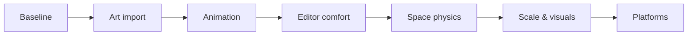

# SatEngine roadmap

SatEngine already lets you open a project, place objects, script them in Lua, play
in the editor, and ship a standalone Windows build. This roadmap is the planned
path from that foundation toward a comfortable tool for making space games.

Priorities lean toward **getting art and motion into the engine**, then making  
the editor nicer to live in, then deepening space-sim physics and polish.  
Cross-platform support and “full engine” extras come later and only when they  
matter for a real game.

---

## At a glance

| Status                   | Focus                             | What it unlocks                                        |
| ------------------------ | --------------------------------- | ------------------------------------------------------ |
| Done                     | **Working baseline**              | Edit, play, script, physics, audio, UI, package a game |
| **Next**                 | **Better art import**             | Drop in modern mesh files (glTF) instead of OBJ-only   |
| Soon                     | **Animation**                     | Moving parts, crew, hatches, turrets, simple cutscenes |
| Soon                     | **Editor comfort**                | Undo, snapping, easier multi-object layout             |
| Later                    | **Richer space physics**          | Docking joints, hinged parts, better station collision |
| Later                    | **Bigger projects**               | Faster iteration as scenes and asset folders grow      |
| Later                    | **Visual polish**                 | Better local lights, shadows, and sky                  |
| Other platforms is Maybe | **Other platforms & stable APIs** | macOS / Linux, APIs that won’t keep shifting           |
| Maybe                    | **Extras**                        | Particles, AI, saves, if a game needs them             |

---

## What’s already here

You can use SatEngine today for a small space-game prototype on Windows:

- An ImGui editor with hierarchy, inspector, content browser, and scene / game views
- Lua scripts driving gameplay, with physics, audio, input, and on-screen UI
- Forward PBR lighting, directional shadows, and materials
- Static OBJ meshes and common image textures
- Rigid bodies with local gravity (no forced “down”)
- Spatial audio and an RmlUi HUD
- **Build → Build Standalone** to produce a player `.exe` and packed content

More detail: [README](../README.md) and the guides in this `docs/` folder.

---

## Next — better art import

**Goal:** bring ships and stations in from normal DCC tools without converting
everything to OBJ first.

Today the engine loads OBJ meshes well, but lighting and materials already expect
richer content. Supporting **glTF** (meshes, materials, textures) is the main
next step, plus a small example that packs and runs as a standalone build.

Animation (skinned meshes) waits until this import path exists. FBX is only on
the table if glTF turns out not to be enough.

---

## Soon — animation

**Goal:** things in the scene can move with authored animation — not only rigid
physics.

Think opening hangar doors, rotating turrets, walking crew, or short cinematic
beats. You’ll play clips from the editor and from Lua. Full animation graphs,
retargeting, and facial systems are out of scope for this pass.

---

## Soon — editor comfort

**Goal:** layout and tweak scenes without fear of irreversible mistakes.

The transform tools already move, rotate, and scale. What’s still missing for
day-to-day authoring ([details](SceneTransforms.md)):

- Undo / redo
- Grid and angle snap
- Plane-move handles
- Transforming several selected objects together

---

## Later — richer space physics

**Goal:** gameplay pieces that attach and articulate, not only free-floating
bodies.

Useful for docking clamps, turrets, cargo arms, and station collision that
matches the visible mesh more closely. Character controllers only matter if the
game wants EVA or walkable interiors.

Still intentionally out of scope for now ([Physics](Physics.md)): full N-body
orbits, planet-sized colliders, and networked physics.

---

## Later — bigger projects & visuals

**Bigger projects:** as folders grow, waiting on manual reimport and fully
in-memory packs gets annoying. Planned improvements include watching assets for
changes, smoother loading, and leaner packaged builds. Prefabs or multiple
scenes are optional extras when a single scene file isn’t enough.
([Asset loading](AssetLoading.md))

**Visuals:** lighting is already good enough for demos ([Lighting](Lighting.md)).
Later work fills gaps that show up in stations and interiors — local light
shadows, a stronger sky / environment look, and cleaner transparency — without
throwing away the current renderer.

---

## Future — other platforms & stable APIs

Windows is the focus until the content and packaging story feels solid for an
actual game. After that:

- Lock down public C++ and Lua surfaces so projects don’t break every week
- Consider macOS / Linux editor or player builds
- Add another graphics backend only if those platforms need it

---

## Maybe — only if the game needs it

These are normal “engine checklist” items, not SatEngine commitments:

| When a game needs… | Worth adding… |
| --- | --- |
| Thruster plumes, weapon hits, atmosphere FX | A particle / VFX system |
| Crew or enemies beyond hand-written Lua | AI / navigation |
| Career progress between sessions | Save games / checkpoints |
| Stick-and-throttle flight | Gamepad support |
| Online multiplayer | Networking |
| A public release | A chosen license |

---

## Guiding idea

SatEngine is aimed at **space games**: vacuum, local gravity, ships, stations,
and Lua-driven play. Features that don’t serve that — or that fight the current
Windows / D3D11 / Lua stack — stay off the critical path until a real project
asks for them.
